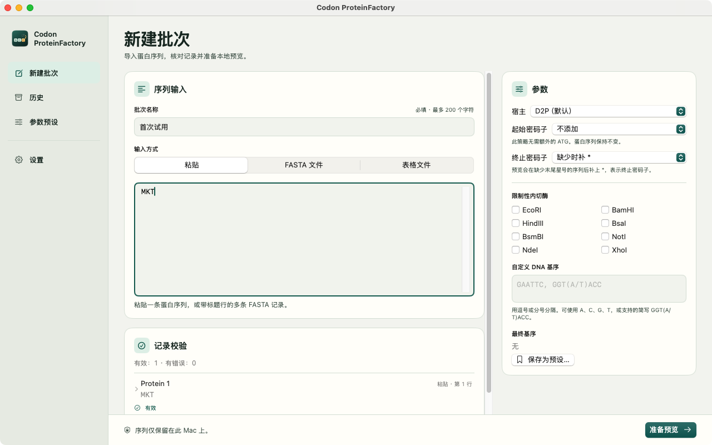

# Codon ProteinFactory

Codon ProteinFactory 是一款支持 macOS 和 Windows 的桌面应用，用于批量导入蛋白序列、检查输入，并将确认后的批次提交给密码子优化服务。你可以先在本机保存草稿，之后在历史中查看处理状态、核验结果和导出文件。



## 安装

macOS 和 Windows 安装包及 SHA-256 校验文件可从 [GitHub Releases](https://github.com/devxia/pie-codon-proteinfactory/releases/latest) 下载。

### macOS

需要 **macOS 14 或更新版本**。0.1.0 通用安装包支持 Apple 芯片和 Intel 芯片的 Mac。

1. 打开 `Pie-Codon-ProteinFactory-0.1.0-macos-universal.dmg`。
2. 把 **Codon ProteinFactory** 拖到同一窗口里的 **Applications** 快捷方式。
3. 从访达的「应用程序」打开 **Codon ProteinFactory**。如果 macOS 提示无法验证开发者，先向软件提供方确认安装包来源。

### Windows 11 x64

当前版本为 **0.1.0 测试版**，支持 Windows 11 25H2 或更新版本。运行 `Pie-Codon-ProteinFactory-0.1.0-win-x64.exe`，在「选择安装位置」保留默认目录 `C:\Program Files\Codon Protein Factory` 或选择其他目录，安装后从「开始」菜单打开 **Codon ProteinFactory**。

Windows 源码、测试和 PowerShell 脚本均位于 `Windows/`，共用测试样例位于 `Compatibility/`。在仓库根目录运行以下命令可测试或重新打包。

```powershell
powershell -ExecutionPolicy Bypass -File Windows/Scripts/test.ps1
powershell -ExecutionPolicy Bypass -File Windows/Scripts/build-installer.ps1
```

## 保存第一份本地草稿

1. 打开 **新建批次**，把批次名称填为 `首次试用`，选择 **粘贴**，输入示例 `MKT`。
2. 等 **记录校验** 显示 1 条有效记录，点击右下角的 **准备预览**。
3. 在 **本地预览** 核对记录，点击 **保存本地草稿**。应用会打开 **历史**，并显示该批次的状态为 **本地草稿**。

整个试用流程在这台 Mac 上完成。默认终止策略下，预览中的拟提交序列会带有末尾的 `*`，原始序列仍显示为 `MKT`。

## 导入自己的记录

- 选择 **粘贴**，输入一条蛋白序列，或粘贴多条带 `>` 标题行的 FASTA 记录。
- 选择 **FASTA 文件**，导入 UTF-8 编码的 `.fasta`、`.faa`、`.fa`、`.fas` 或 `.txt` 文件。
- 选择 **表格文件**，导入 `.xlsx`、`.csv` 或 `.tsv`。XLSX 可切换工作表。检查 **首行是表头** 的设置，然后分别为 **名称** 和 **蛋白序列** 指定不同的列。

单个导入文件上限为 5 MiB。每批最多 200 条记录，每条规范化序列最多 10,000 个字符，每批总计最多 200,000 个字符。表格的读取上限为 2,000 行、100 列。若 **准备预览** 不可用，先填写批次名称，再按 **记录校验** 标出的来源位置修正输入。

## 提交批次和查看结果

1. 在 **本地预览** 展开 **预览详情**，核对参数和 **接收方 URL**。点击 **提交并开始优化** 后，在确认框中确认发送。已经保存的草稿可从 **历史** 打开，再点 **提交优化**。
2. 在 **历史** 按批次名称或状态查找批次。应用逐条发送请求。选择记录后，可以查看已保存的 DNA、核验状态和请求尝试。状态为 **未知** 时，表示应用无法确认服务器是否完成了该次请求，可先查看请求详情。

导入、预览和保存草稿都在本机完成。确认提交后，应用才会向优化服务发送该批次的拟提交蛋白序列和参数。返回的 DNA 和请求记录会保存在本机历史中。

## 导出与设置

选中 **历史** 中的批次，打开 **操作** 菜单。

- **原始蛋白 FASTA**包含批次中的原始蛋白序列。保存草稿后即可导出。
- **本地审计 ZIP**包含原始蛋白 FASTA、批次和请求元数据，以及文件说明。
- **基因合成 CSV**包含已完成且通过核验的 DNA 结果及对应的蛋白记录。至少有一条完成记录时可选择此项。

单次导出上限为 10 MiB。导出文件可能含有序列数据，请保存到合适的位置。

- **参数预设**可在「新建批次」的参数面板中保存，也可以从侧栏的「参数预设」应用到当前草稿。
- 在 **设置** 中可切换浅色、深色或跟随系统，也可选择简体中文或英语。语言切换在重启应用后生效。
- 从 **设置 → 本地存储 → 在访达中显示** 可以打开数据文件夹。
